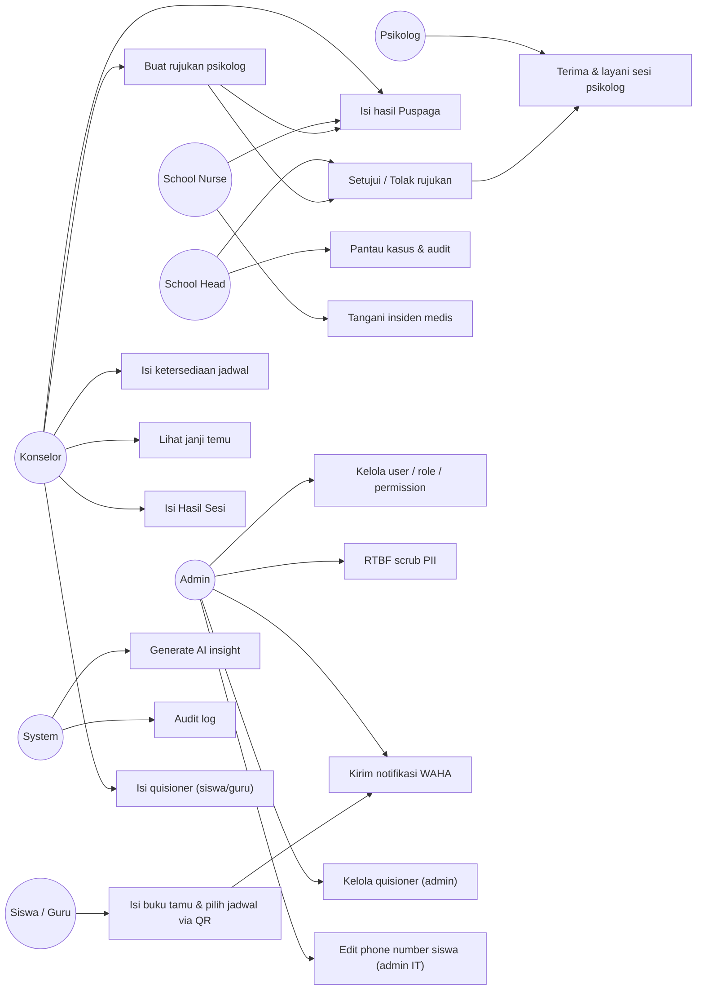
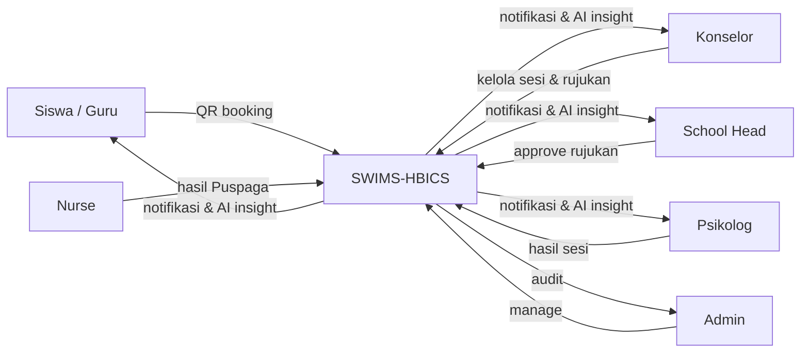
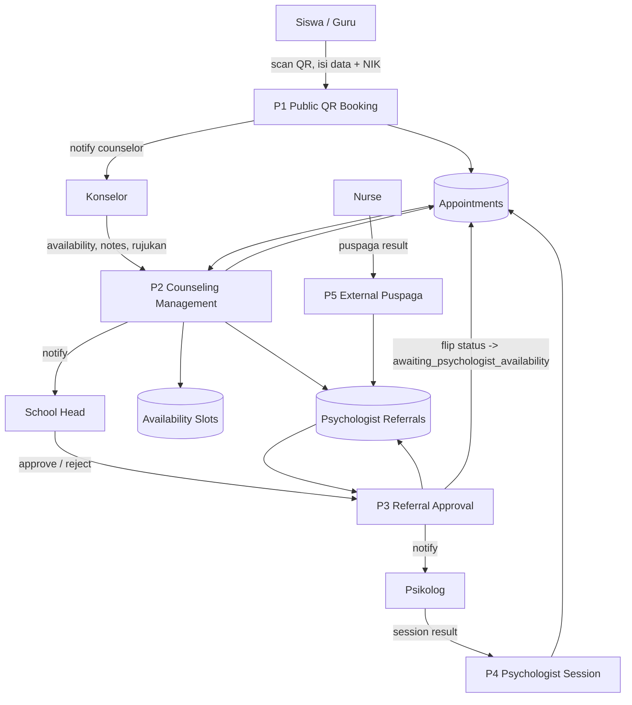
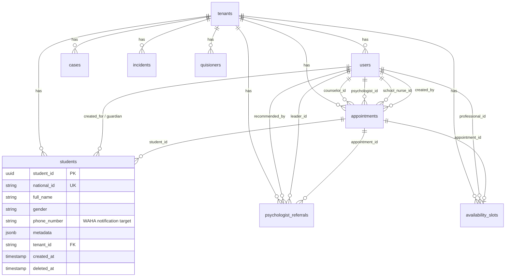
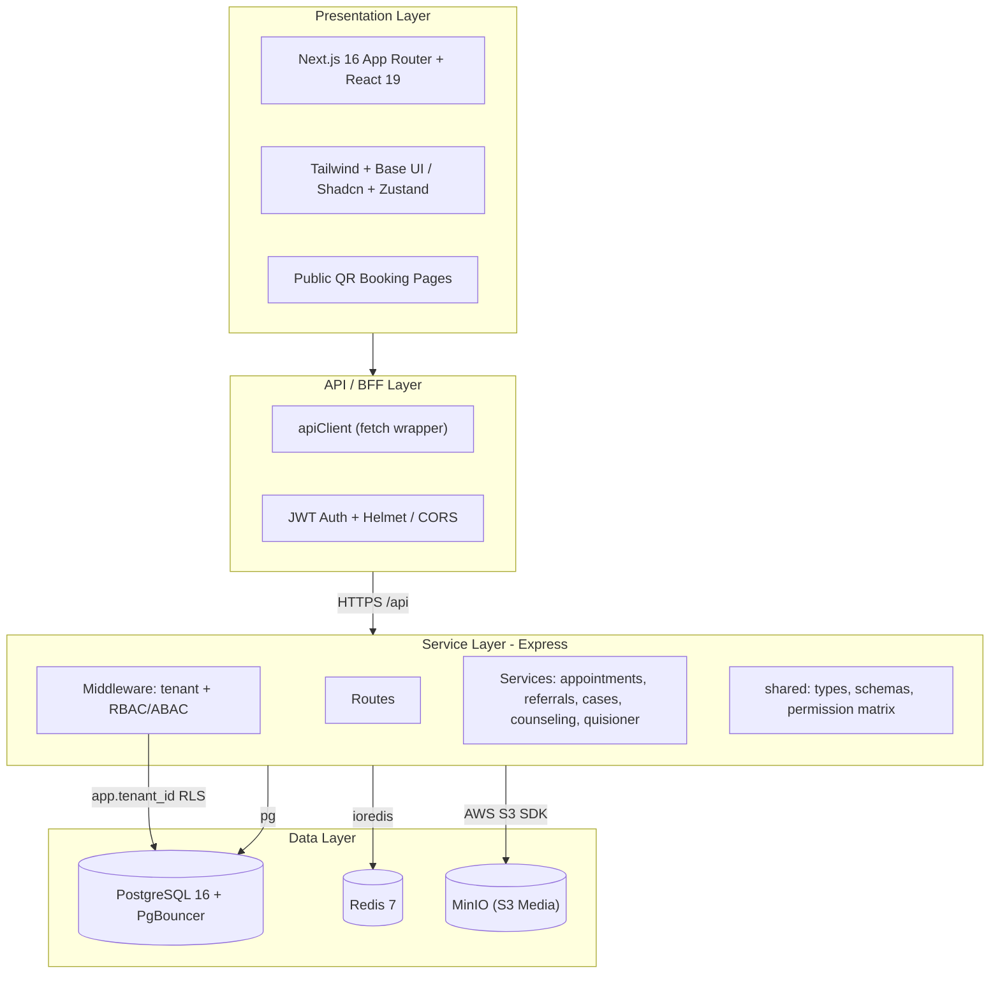

# SWIMS (Student Wellbeing and Incident Management System)

SWIMS is a comprehensive, multi-tenant SaaS platform designed to help schools and educational institutions monitor student wellbeing, manage disciplinary and medical cases, track interventions, and generate advanced analytics. 

Built with modern web technologies, SWIMS features a robust Role-Based Access Control (RBAC) and Attribute-Based Access Control (ABAC) system, ensuring data privacy and security across various user roles (e.g., Counselors, Teachers, IT Admins, School Heads, Nurses, etc.).

## 🚀 Key Features

- **Multi-Tenant SaaS Architecture**: Scalable architecture to support multiple schools/districts within a single deployment.
- **Granular Access Control**: Advanced RBAC and ABAC ensuring data minimization, privacy, and contextual access (e.g., Teachers only see their assigned students, Nurses only handle medical incidents). Permissions are dynamic per-role via IT Admin dashboard.
- **Incident & Case Management**: Complete lifecycle tracking for behavioral and medical incidents, case escalations, and interventions.
- **Positive Observations**: Dedicated tracking for positive reinforcement and student achievements.
- **AI-Powered Insights**: Integrated AI analysis (powered by Ollama/Local LLMs) to detect patterns, evaluate intervention efficacy, and summarize student records.
- **Secure Media Assets**: AWS S3/Firebase integrated secure file handling, redaction support, and presigned uploads for sensitive evidence tracking.
- **Right to Be Forgotten (RTBF)**: Compliance with data privacy regulations (GDPR/FERPA) allowing IT Admins to securely scrub PII.
- **Comprehensive Audit Logging**: Immutable audit trails for all sensitive data access and system modifications.
- **WAHA WhatsApp Integration**: Appointment notifications sent automatically via WAHA HTTP API to student/guardian phone numbers. Phone numbers managed by IT Admin.
- **Quisioner Module**: Staff and student quisioner forms for data collection. IT Admin manages quisioner configuration.
- **Social Media Scheduling (Repliz)**: Automated daily Threads/Twitter posts via Repliz API — news threads, quotes, and motivational content scheduled at peak engagement hours (WIB).

## 🛠 Tech Stack

### Frontend
- **Framework**: [Next.js](https://nextjs.org/) 16 (App Router) + React 19
- **Language**: TypeScript 5
- **Styling**: Tailwind CSS 4 + Base UI / Shadcn UI + Radix primitives
- **State & Data Fetching**: Zustand (global state) + custom `apiClient` (fetch wrapper)
- **Utilities**: lucide-react (icons), sonner (toasts), date-fns, qrcode.react (QR booking), papaparse

### Backend
- **Runtime**: Node.js 20 (Alpine) + [Express](https://expressjs.com/) 4
- **Language**: TypeScript 5 (dev via `tsx watch`, build via `tsc`)
- **Database**: PostgreSQL 16 + PgBouncer (connection pooling) via `pg`
- **Cache / Jobs**: Redis 7 (`ioredis`), node-cron
- **Object Storage**: MinIO (S3-compatible) via AWS SDK S3
- **Validation**: Zod
- **Auth**: JWT (`jsonwebtoken`) + `bcryptjs`; Firebase SSO-ready
- **Mail / PDF**: nodemailer, pdfkit
- **WhatsApp**: WAHA HTTP API (`axios`) — appointment notifications to student/guardian phones
- **Social Media**: Repliz API (`axios`) — automated Threads/Twitter scheduling
- **Testing**: Vitest + Supertest
- **AI**: Ollama integration for on-premise/local LLM insights

### Infrastructure
- **Orchestration**: Docker Compose (postgres, pgbouncer, redis, minio, backend, frontend)
- **Multi-tenancy**: faux Row-Level Security via `app.tenant_id` session config + tenant-scoped queries

## 📁 Project Structure

This project is organized as a monorepo containing the following workspaces:

```text
SWIMS/
├── frontend/           # Next.js web application
├── backend/            # Express.js REST API server
├── shared/             # Shared TypeScript types, schemas, and permissions matrix
└── docker-compose.yml  # Docker environment orchestration (DB, Redis, etc.)
```

## ⚙️ Getting Started

### Prerequisites
- Node.js (v18+)
- PostgreSQL (v14+)
- Docker (optional, for running local services)

### Installation

1. **Clone the repository**
   ```bash
   git clone https://github.com/dedebono/SWIMS-HBICS.git
   cd SWIMS
   ```

2. **Install dependencies**
   Install packages from the root of the project to setup the monorepo workspaces:
   ```bash
   npm install
   ```

3. **Configure Environment Variables**
   - Copy `.env.example` to `.env` in both the `frontend` and `backend` directories.
   - Update the configuration values (Database connection, JWT secrets, etc.).

4. **Database Setup & Migrations**
   Initialize the PostgreSQL database:
   ```bash
   cd backend
   npm run migrate
   npm run seed
   ```

### Running Locally

You can run both the frontend and backend concurrently from the root (if configured), or run them individually:

**Backend API:**
```bash
cd backend
npm run dev
```

**Frontend App:**
```bash
cd frontend
npm run dev
```

### Running Tests
The backend test suite ensures 100% stability across all endpoint validations and permissions.
```bash
cd backend
npm run test
```

## 🔒 Security & Privacy
SWIMS is built with student privacy as a primary concern. Features like strict RBAC/ABAC matrices, automated data redaction, secure media URLs, and extensive audit logging ensure compliance with educational data standards.

## 📐 System Documentation & Diagrams

### 🗺 Site Map

```mermaid
graph TD
  A["SWIMS-HBICS"] --> PUB["Public / No Auth"]
  A --> AUTH["Dashboard - Role Based"]

  PUB --> QR["/qr/[token] - Public Counseling Booking"]
  PUB --> QS["/quisioner/staff - Staff Quisioner Form"]
  PUB --> LG["/login"]

  AUTH --> CO["Counselor"]
  AUTH --> PS["School Psychologist"]
  AUTH --> SH["School Head"]
  AUTH --> NU["School Nurse"]
  AUTH --> AD["IT Admin / Super Admin"]
  AUTH --> TC["Teacher / Substitute"]
  AUTH --> ST["Student"]
  AUTH --> RV["Reviewer"]

  CO --> CO1["Dashboard"]
  CO --> CO2["Availability - set counseling schedule"]
  CO --> CO3["Janji Temu & Rujukan Saya: Hasil Sesi + Buat Rujukan + Hasil Puspaga"]
  PS --> PS1["Dashboard"]
  PS --> PS2["Availability"]
  PS --> PS3["Janji Temu Psikolog (awaiting_psychologist_availability)"]
  SH --> SH1["Dashboard + Pending Approvals"]
  SH --> SH2["Persetujuan Rujukan (Approve / Reject)"]
  SH --> SH3["Audit Logs"]
  NU --> NU1["Medical Incidents"]
  NU --> NU2["Isi Hasil Puspaga"]
  AD --> AD1["User / Role / Permission Mgmt"]
  AD --> AD2["Tenant Settings + RTBF"]
  AD --> AD3["Quisioner Management"]
  AD --> AD4["Discipline Handbook"]
  TC --> TC1["Students / Incidents / Cases / Observations / Quisioner"]
  ST --> ST1["Own records / Quisioner"]
  RV --> RV1["Dashboard / Board - aggregated view"]
```



### 👥 Use Case Diagram



### 🔄 Data Flow Diagram (DFD)

**Level 0 — Context**



**Level 1 — Counseling / Referral Flow**



### 🔗 Entity Relationship Diagram (ERD)



> Core entities shown; all tables carry `tenant_id` for multi-tenancy. `psychologist_referrals` is the Fase-2 referral table (counselor → School Head approval → internal psychologist / external Puspaga).

### 🏛 Architecture Layer Diagram



### 🏗 Construction / Running the Application

SWIMS is a monorepo with three workspaces: `frontend` (Next.js), `backend` (Express + tsx), and `shared` (TypeScript types, Zod schemas, permission matrix consumed by both sides).

**Local development**
```bash
# root
npm install                 # installs all workspaces
cp .env.example .env        # fill DB / JWT / S3 secrets (root .env is used by backend)
# build shared first (frontend & backend import @swims/shared -> dist/)
cd shared && npm run build && cd ..

# terminals
cd backend  && npm run dev          # tsx watch src/server.ts (auto-runs migrate on start)
cd frontend && npm run dev          # next dev
```

**Docker (recommended)**
```bash
# 1) prune old images/build cache (keeps volumes)
sudo docker system prune -a -f
sudo docker builder prune -f

# 2) build shared dist, then compose up (frontend = prod build, backend = dev + auto migrate)
cd shared && npm run build && cd ..
docker compose up -d --build
```
- `swims_backend` runs `npm run migrate && npm run dev:backend` on start (migrations auto-applied).
- `swims_frontend` is a baked production `next start` image (no source bind-mount).
- Services: postgres (5432), pgbouncer (6432), redis (6379), minio (9000/9001).

**Scripts**
```bash
cd backend
npm run migrate     # apply SQL migrations
npm run seed        # seed tenants / roles / demo users
npm run test        # vitest + supertest
npm run typecheck   # tsc --noEmit
```

## 📄 License
This project is proprietary and confidential. Unauthorized copying, distribution, or use is strictly prohibited.
