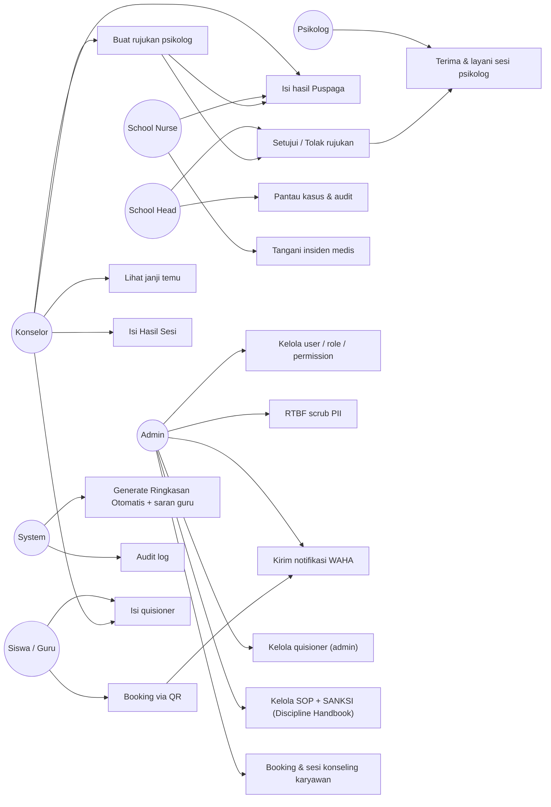
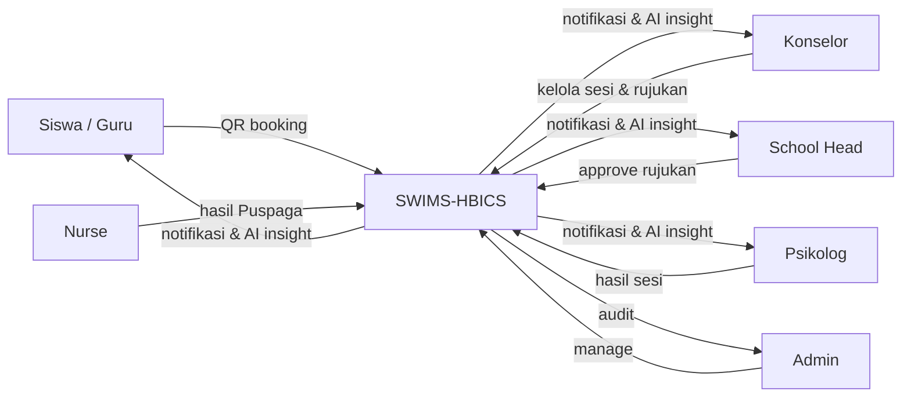
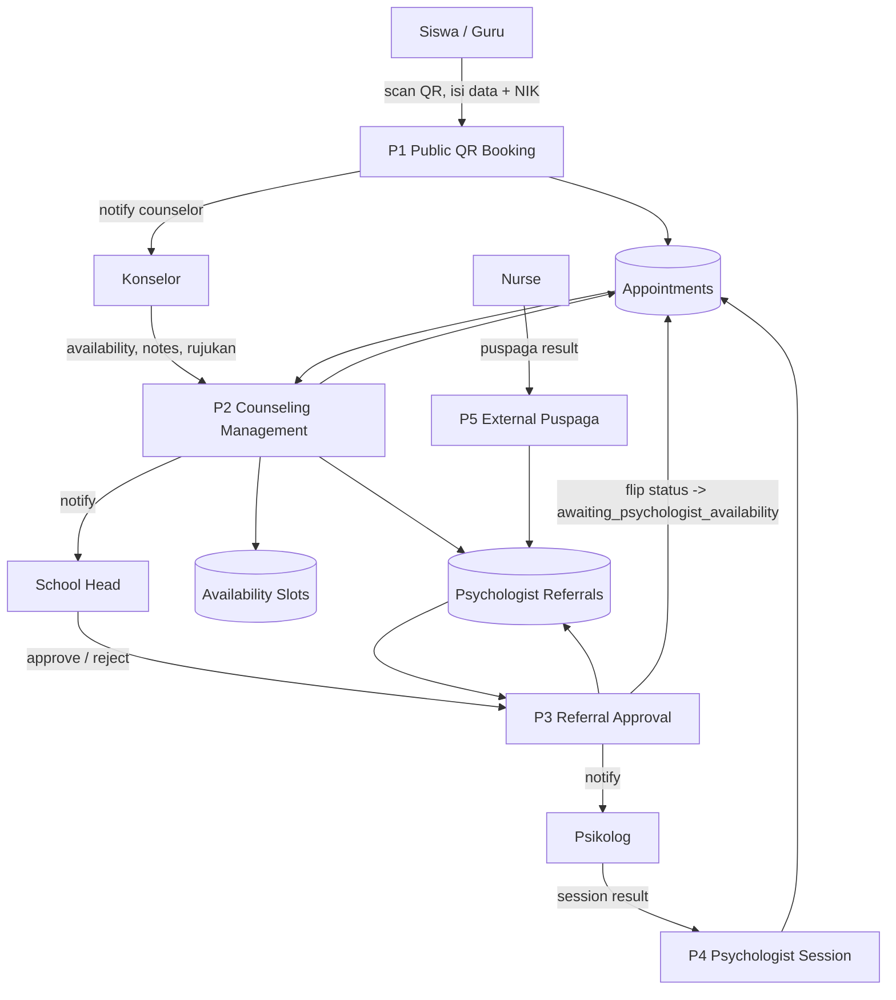
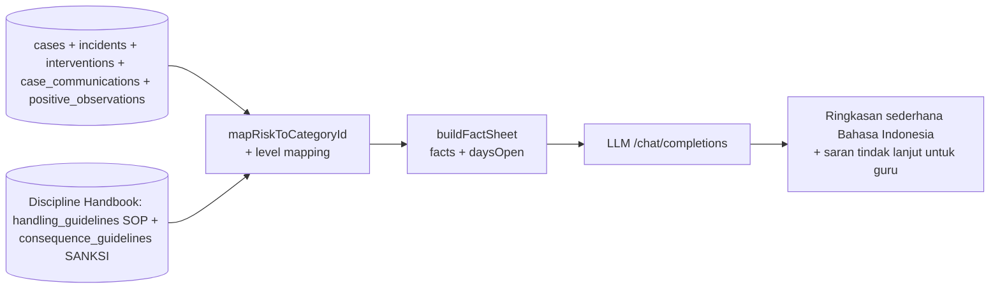
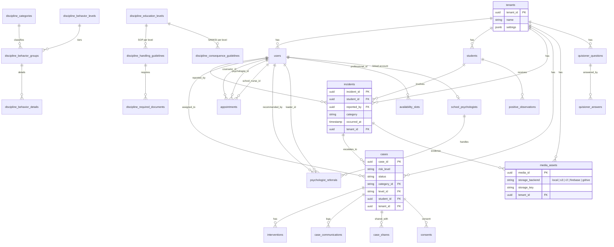
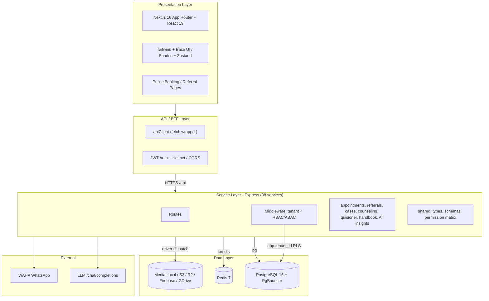

# SWIMS (Student Wellbeing and Incident Management System)

SWIMS is a comprehensive, multi-tenant SaaS platform designed to help schools and educational institutions monitor student wellbeing, manage disciplinary and medical cases, track interventions, and generate advanced analytics.

Built with modern web technologies, SWIMS features a robust Role-Based Access Control (RBAC) and Attribute-Based Access Control (ABAC) system, ensuring data privacy and security across various user roles (Counselors, Teachers, IT Admins, School Heads, Nurses, Reviewers, etc.).

## 🚀 Key Features

- **Multi-Tenant SaaS Architecture**: Scalable architecture to support multiple schools/districts within a single deployment.
- **Granular Access Control**: RBAC + ABAC with a **single source of truth** for roles and permissions — permissions are dynamic per-role and editable from the IT Admin dashboard. Teachers only see their assigned students; Nurses only handle medical incidents.
- **Incident & Case Management**: Complete lifecycle tracking for behavioral and medical incidents, case escalations, and interventions.
- **Communication Logs**: Per-case log of parent/guardian contact (channel, outcome, follow-up) so the full communication history lives with the case.
- **Discipline Handbook (Buku Pedoman Disiplin)**: Structured reference data — categories, behavior groups, detail characteristics, education levels, **handling guidelines (SOP)**, and **consequence guidelines (SANKSI)**. Teachers and admins maintain it; the AI reads it.
- **AI-Powered Insights**: Configurable OpenAI-compatible LLM integration (API URL + key + model set per-tenant in IT Admin settings). Generates **Ringkasan Otomatis** in plain, simple Indonesian and **saran tindak lanjut untuk guru**. The AI reads the full case context — case detail, every incident, interventions, parent communication log, positive observations — and matches them against the Handbook's **SOP and SANKSI** for the case's category and education level.
- **Secure Media Assets**: Multi-provider storage (**local / S3 / R2 / Firebase / Google Drive**) with redaction support and presigned uploads. Each asset records its own `storage_backend`, so switching providers never orphans existing files.
- **Right to Be Forgotten (RTBF)**: Compliance with data privacy regulations (GDPR/FERPA) allowing IT Admins to securely scrub PII.
- **Comprehensive Audit Logging**: Immutable audit trails for all sensitive data access and system modifications.
- **WAHA WhatsApp Integration**: Appointment notifications sent automatically via WAHA HTTP API to student/guardian phone numbers. Phone numbers managed by IT Admin.
- **Employee Counseling**: Confidential booking and session module for staff, with separate access logging.
- **Psychologist Referral**: Counselor → School Head approval → internal school psychologist or external Puspaga.
- **Quisioner Module**: Configurable question lists managed by IT Admin; staff, student, employee-counseling, and referral forms.
- **Social Media Scheduling (Repliz)**: Automated daily Threads/Twitter posts via Repliz API — news threads, quotes, and motivational content scheduled at peak engagement hours (WIB).

## 🛠 Tech Stack

### Frontend
- **Framework**: [Next.js](https://nextjs.org/) 16 (App Router) + React 19
- **Language**: TypeScript 5
- **Styling**: Tailwind CSS 4 + Base UI / Shadcn UI + Radix primitives
- **State & Data Fetching**: Zustand (global state) + custom `apiClient` (fetch wrapper)
- **Utilities**: lucide-react (icons), sonner (toasts), date-fns, qrcode.react (QR booking), papaparse

> **Base UI note**: Base UI `<Select>` does not derive a label from `<SelectItem>` children — pass an `items` map (`id → label`) to `<Select>` or the trigger renders the raw value (e.g. a UUID).

### Backend
- **Runtime**: Node.js 20 (Alpine) + [Express](https://expressjs.com/) 4
- **Language**: TypeScript 5 (dev via `tsx watch`, build via `tsc`)
- **Database**: PostgreSQL 16 + PgBouncer (connection pooling) via `pg`
- **Cache / Jobs**: Redis 7 (`ioredis`), node-cron
- **Validation**: Zod
- **Auth**: JWT (`jsonwebtoken`) + `bcryptjs`
- **Mail / PDF**: nodemailer, pdfkit
- **WhatsApp**: WAHA HTTP API (`axios`)
- **Social Media**: Repliz API (`axios`)
- **Testing**: Vitest + Supertest
- **AI**: OpenAI-compatible `/chat/completions` — endpoint, key, and model configured per-tenant via IT Admin settings

### Infrastructure
- **Orchestration**: Docker Compose (postgres, pgbouncer, redis, backend, frontend)
- **Multi-tenancy**: faux Row-Level Security via `app.tenant_id` session config + tenant-scoped queries

## 📁 Project Structure

This project is organized as a monorepo containing the following workspaces:

```text
SWIMS/
├── frontend/           # Next.js web application
├── backend/            # Express.js REST API server
│   └── src/db/migrations/   # 51 numbered SQL migrations
├── shared/             # Shared TypeScript types, schemas, and permissions matrix
└── docker-compose.yml  # Docker environment orchestration (DB, Redis, etc.)
```

## ⚙️ Getting Started

### Prerequisites
- Node.js (v18+)
- PostgreSQL (v14+)
- Docker (optional, for running local services)

### Installation

1. **Clone the repository**
   ```bash
   git clone https://github.com/dedebono/SWIMS-HBICS.git
   cd SWIMS-HBICS
   ```

2. **Install dependencies**
   Install packages from the root of the project to setup the monorepo workspaces:
   ```bash
   npm install
   ```

3. **Configure Environment Variables**
   - Copy `.env.example` to `.env` in both the `frontend` and `backend` directories.
   - Update the configuration values (Database connection, JWT secrets, etc.).

4. **Database Setup & Migrations**
   Initialize the PostgreSQL database:
   ```bash
   cd backend
   npm run migrate
   npm run seed
   ```

### Running Locally

You can run both the frontend and backend concurrently from the root (if configured), or run them individually:

**Backend API:**
```bash
cd backend
npm run dev
```

**Frontend App:**
```bash
cd frontend
npm run dev
```

### Running Tests
The backend test suite ensures stability across all endpoint validations and permissions.
```bash
cd backend
npm run test        # vitest + supertest
```

> **Known pre-existing issue**: `npm run typecheck` (`tsc --noEmit`) currently reports errors that predate recent feature work. Use `npm run test` as the verification gate.

## 🔒 Security & Privacy
SWIMS is built with student privacy as a primary concern. Features like strict RBAC/ABAC matrices, automated data redaction, secure media URLs, and extensive audit logging ensure compliance with educational data standards.

**Credential handling**: secrets are read from environment variables at runtime — never hardcoded. Never hand-retype a credential to restore or verify one; pull the real value from `.env` or the database and pipe it through without echoing it. Redacted placeholders written back to config will silently corrupt production keys.

## 📐 System Documentation & Diagrams

### 🗺 Site Map

```mermaid
graph TD
  A["SWIMS-HBICS"] --> PUB["Public / No Auth"]
  A --> AUTH["Dashboard - Role Based"]

  PUB --> QR["/qr/[token] - Public Counseling Booking"]
  PUB --> QS["/quisioner/book - Booking Form"]
  PUB --> PR["/quisioner/psychologist-referral - Public Referral"]
  PUB --> BS["/book/staff - Employee Counseling"]
  PUB --> LG["/login"]

  AUTH --> CO["Counselor"]
  AUTH --> SH["School Head"]
  AUTH --> NU["School Nurse"]
  AUTH --> AD["IT Admin / Super Admin"]
  AUTH --> TC["Teacher / Substitute"]
  AUTH --> PS["School Psychologist"]
  AUTH --> RV["Reviewer"]
  AUTH --> ST["Student"]

  CO --> CO1["Dashboard"]
  CO --> CO2["Janji Temu & Rujukan"]
  CO --> CO3["Employee Counseling + Sesi"]
  SH --> SH1["Dashboard + Pending Approvals"]
  SH --> SH2["Persetujuan Rujukan"]
  SH --> SH3["Audit Logs"]
  NU --> NU1["Medical Incidents"]
  NU --> NU2["Hasil Puspaga"]
  AD --> AD1["User / Role / Permission Mgmt"]
  AD --> AD2["Tenant Settings + RTBF"]
  AD --> AD3["Quisioner Management"]
  AD --> AD4["Discipline Handbook (SOP + SANKSI)"]
  AD --> AD5["Psychologists Management"]
  AD --> AD6["Employee Counseling Access"]
  TC --> TC1["Students / Incidents / Cases / Observations"]
  TC --> TC2["Discipline Handbook (read)"]
  PS --> PS1["Psychologist Dashboard + Sesi"]
  RV --> RV1["Dashboard / Board"]
  ST --> ST1["Own records / Quisioner"]
```



### 👥 Use Case Diagram



### 🔄 Data Flow Diagram (DFD)

**Level 0 — Context**



**Level 1 — Counseling / Referral Flow**



**Level 2 — AI Ringkasan Otomatis**



### 🔗 Entity Relationship Diagram (ERD)



> Core entities shown; all tables carry `tenant_id` for multi-tenancy. Media reads dispatch on each asset's own `storage_backend`, not the tenant's current setting.

**Domain groups** (51 migrations): counseling & referral, incidents/cases/interventions, discipline handbook (9 tables), quisioner, employee counseling, media & RTBF, tenants/users/roles, scheduling (homeroom, teacher class, substitution), reports & cold archive.

### 🏛 Architecture Layer Diagram



### 🏗 Construction / Running the Application

SWIMS is a monorepo with three workspaces: `frontend` (Next.js), `backend` (Express + tsx), and `shared` (TypeScript types, Zod schemas, permission matrix consumed by both sides).

**Local development**
```bash
# root
npm install                 # installs all workspaces
cp .env.example .env        # fill DB / JWT / S3 secrets (root .env is used by backend)
# build shared first (frontend & backend import @swims/shared -> dist/)
cd shared && npm run build && cd ..

# terminals
cd backend  && npm run dev          # tsx watch src/server.ts (auto-runs migrate on start)
cd frontend && npm run dev          # next dev
```

**Docker (recommended)**
```bash
# 1) prune old images/build cache (keeps volumes)
sudo docker system prune -a -f
sudo docker builder prune -f

# 2) build shared dist, then compose up (frontend = prod build, backend = dev + auto migrate)
cd shared && npm run build && cd ..
docker compose up -d --build
```
- `swims_backend` runs `npm run migrate && npm run dev:backend` on start (migrations auto-applied).
- `swims_frontend` is a **baked production `next start` image** — there is no source bind-mount, so frontend changes require a rebuild of the image.
- Services: postgres (5432), pgbouncer (6432), redis (6379), backend, frontend. Object storage is external (S3/R2/Firebase/GDrive) or local disk — no MinIO service.

**Scripts**
```bash
cd backend
npm run migrate     # apply SQL migrations
npm run seed        # seed tenants / roles / demo users
npm run test        # vitest + supertest (use this as the verification gate)
npm run typecheck   # tsc --noEmit (currently has pre-existing errors)
```

## 💾 Backup & Operations

Database backups run **outside** the application, on a host-level scheduler, so a provider outage can never silently skip a backup.

| Job | Schedule | Mechanism |
|---|---|---|
| Local DB backup | `0 3 * * *` | Script-only, no LLM |
| S3 backup | `30 3 * * *` | Script-only, no LLM |

Both jobs are configured with `no_agent: true`, meaning they execute a shell script and need **no model provider or API key**. An earlier LLM-backed variant failed with a provider 401 *before* the script ran, losing a day's upload — hence the script-only design. The watchdog verifies the object exists on S3 after upload (`aws s3 ls`) before reporting success, and alerts only on non-zero exit.

## 📄 License
This project is proprietary and confidential. Unauthorized copying, distribution, or use is strictly prohibited.